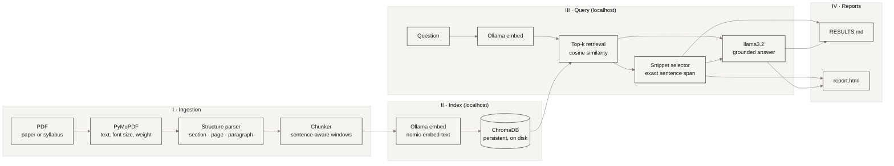

<div align="center">

# É T U D E

*A quiet, local reading room for research papers and course syllabi.*

`PyMuPDF` &nbsp;·&nbsp; `ChromaDB` &nbsp;·&nbsp; `Ollama / llama3.2` &nbsp;·&nbsp; `zero network`

</div>

---

## Nº 01 — Premise

Ask a question of a PDF. Receive an answer, and beneath it the evidence: the **page**, the **paragraph**, the **section heading**, the **exact sentence**, and a **similarity percentage** for every passage the answer leans on.

Everything runs on your machine. Parsing is PyMuPDF, memory is a ChromaDB folder on disk, and thought is `llama3.2` served by Ollama on `localhost`. No API keys, no credits, no telemetry. The tool refuses to talk to any host that is not loopback, and the HTML report ships with a Content-Security-Policy that forbids network requests.

Two kinds of document are first-class: **academic papers** and **course syllabi**. The tool detects which it is reading and asks sensible default questions of each.

## Nº 02 — Architecture



| Stage | What happens | Where |
|---|---|---|
| Ingestion | Every text block is read with its font size and weight. The body size is the most common size in the document; anything larger, bold-and-numbered, or a known heading word (`Methodology`, `Grading`…) becomes a section heading. | `extract_blocks`, `build_paragraphs` |
| Chunking | One paragraph is one passage. Paragraphs over 1,000 characters are split on sentence boundaries with one sentence of overlap. | `chunk_paragraph` |
| Index | Each passage is embedded as *section heading + text* and stored with its page, paragraph and section as metadata. | `ingest` |
| Retrieval | The question is embedded, the nearest passages are fetched, and similarity is recomputed from the returned vectors. | `retrieve` |
| Snippet | Inside each passage, the sentence with the greatest vocabulary overlap with the question is cut out as a literal slice. | `best_snippet` |
| Answer | `llama3.2` receives only the retrieved passages, numbered, and is told to cite them. Citations to numbers that do not exist are flagged. | `generate`, `audit_answer` |

## Nº 03 — Installation

```bash
# 1. Ollama: https://ollama.com  (install once)
ollama pull llama3.2            # inference
ollama pull nomic-embed-text    # embeddings (strongly recommended)

# 2. Python 3.10+
python -m venv .venv && source .venv/bin/activate
pip install -r requirements.txt
```

The two `ollama pull` commands and `pip install` are the only steps that touch the internet. After them you can disconnect for good.

If `nomic-embed-text` is absent, the tool falls back to embedding with `llama3.2` and says so. It works, but retrieval is noticeably weaker.

## Nº 04 — Usage

```bash
# Defaults: three questions suited to the document kind (paper or syllabus)
python pdf_analyzer.py paper.pdf

# Your own questions, across several documents
python pdf_analyzer.py paper.pdf syllabus.pdf \
    -q "What is the sample size?" -q "How is participation graded?"

# A prompt that stays open; an empty line writes the reports
python pdf_analyzer.py paper.pdf -i

# Evidence only, no generation
python pdf_analyzer.py paper.pdf -q "limitations" --no-llm
```

Reports land in `./output/` as `RESULTS.md` and `report.html`.

| Flag | Default | Purpose |
|---|---|---|
| `-q, --question` | kind-specific | Question to ask. Repeatable. |
| `-i, --interactive` | off | Ask follow-ups at a prompt. |
| `-k, --top-k` | `5` | Passages retrieved per question (1–12). |
| `--min-score` | `0` | Drop passages whose match falls below this percentage. |
| `--kind` | `auto` | Force `paper` or `syllabus`. |
| `--model` | `llama3.2` | Ollama chat model. |
| `--embed-model` | `nomic-embed-text` | Ollama embedding model. |
| `--db` | `.rag_db` | ChromaDB directory. |
| `--out` | `output` | Report directory. |
| `--no-llm` | off | Retrieval and citations only. |
| `--reindex` | off | Re-embed even if the PDF is already indexed. |
| `--keep-references` | off | Index the bibliography as well (skipped by default). |

Passing a PDF again is cheap. It is re-parsed, but its embeddings are cached by content hash.

## Nº 05 — Anatomy of a citation

| Field | How it is computed |
|---|---|
| **Page** | The 1-based PDF page on which the paragraph begins. |
| **Paragraph** | The paragraph's ordinal on that page, counting only substantive body text. Headings, captions, running heads, page numbers and fragments under 6 words are not counted. Numbering restarts on every page. |
| **Section** | The nearest heading above the paragraph, as printed (`3. Methodology`). Text before the first heading is `Front matter`. |
| **Quote** | A literal slice of the extracted paragraph: the best-matching sentence, extended by a neighbour when it is short or also relevant, capped at 320 characters. A cut is marked with `…`. |
| **Match** | Cosine similarity between question and passage vectors × 100. |

> **Reading the match.** The percentage ranks passages against one another. It is not a probability that the passage is correct, and its scale depends on the embedding model, so compare passages within a run rather than against a fixed threshold. Use `--min-score` once you have a feel for the range your model produces.

## Nº 06 — The reports

Both reports share one visual grammar, after **JW Anderson's** structural framing and **Lemaire's** muted restraint.

| | Hex | Role |
|---|---|---|
| Warm stone | `#F5F4F0` | Ground |
| Deep espresso | `#1C1B1A` | Type, structure, the match bar |
| Muted slate | `#7E7B75` | Labels, secondary text, outlined numerals |

- **Asymmetric borders.** Each citation carries a heavy top and left edge, a slate base, and an offset frame that only partly encloses it. The masthead rule is doubled at unequal lengths.
- **Hairlines over fills.** Structure comes from 1px rules and a 3px tab, never from boxes of colour.
- **Type.** A light serif for reading (Cormorant Garamond if installed, otherwise Iowan Old Style, Palatino, Georgia), monospace capitals for metadata, outlined numerals for the questions.
- **Offline.** No web fonts, no scripts, no external requests.

`RESULTS.md` keeps to the same restraint: a document register, one evidence table per question, block-character match bars (`▮▮▮▮▮▮▯▯▯▯`) and quoted passages.

## Nº 07 — Limitations

- **Scanned PDFs.** There is no OCR. Pages without a text layer are reported and skipped; run `ocrmypdf` first.
- **Heading and paragraph detection is heuristic.** It reads font size, weight and numbering. Unusual layouts, decorative headings, or multi-column pages whose stream order is scrambled can yield misplaced section names or paragraph numbers. Check the quote.
- **Paragraphs do not cross pages.** A paragraph continued on the next page is cited at the page where each part sits.
- **Small model, honest caveat.** `llama3.2` (3B) can misread or over-compress its sources. The quotes and page references are retrieved, not generated. Treat them as the ground truth and the prose as a reading aid.
- **Tables, figures and equations** are not interpreted; text inside them is indexed only if it forms prose.
- **Quotes are normalised.** Line-wrap hyphens are healed, ligatures (fi, fl) expanded and whitespace collapsed.

## Nº 08 — Troubleshooting

| Symptom | Remedy |
|---|---|
| `Cannot reach Ollama` | Run `ollama serve` (or open the Ollama app). |
| `Model 'llama3.2' is not installed` | `ollama pull llama3.2` |
| Weak or odd retrieval | `ollama pull nomic-embed-text`, then re-run with `--reindex`. |
| Sections come out wrong | Try `--kind syllabus` or `--kind paper`; inspect the quote and its `Full passage` in the HTML report. |
| Changed the embedding model | A new collection is created per embedding model; old indexes are untouched. Delete `.rag_db/` to reclaim space. |

---

<div align="center">

*Colophon.* Set in whatever serif your system keeps best. `PyMuPDF` is licensed AGPL-3.0 (with a commercial option), which is fine for personal and academic use but worth reading before you redistribute anything built on it. Add a `LICENSE` of your choosing for the rest.

</div>
