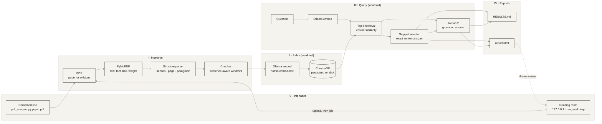

<div align="center">

# É T U D E

*A quiet, local reading room for research papers and course syllabi.*

`PyMuPDF` &nbsp;·&nbsp; `ChromaDB` &nbsp;·&nbsp; `Ollama / llama3.2` &nbsp;·&nbsp; `zero network`

</div>

---

## Nº 01 — Premise

Ask a question of a PDF. Receive an answer, and beneath it the evidence: the **page**, the **paragraph**, the **section heading**, the **exact sentence**, and a **similarity percentage** for every passage the answer leans on.

Everything runs on your machine. Parsing is PyMuPDF, memory is a ChromaDB folder on disk, and thought is `llama3.2` served by Ollama on `localhost`. No API keys, no credits, no telemetry. The tool refuses to talk to any host that is not loopback, and every page it produces ships with a Content-Security-Policy that forbids network requests.

There are two ways in, and they share one engine:

| | Command | For |
|---|---|---|
| **Reading room** | `python pdf_analyzer.py --serve --open` | Dragging PDFs onto a page, asking, reading the report on the spot. |
| **Command line** | `python pdf_analyzer.py paper.pdf -q "…"` | Scripts, batches, quick checks. |

Two kinds of document are first-class: **academic papers** and **course syllabi**. The tool detects which it is reading and asks sensible default questions of each.

## Nº 02 — Architecture



| Stage | What happens | Where |
|---|---|---|
| Ingestion | Every text block is read with its font size and weight. The body size is the most common size in the document; anything larger, bold-and-numbered, or a known heading word (`Methodology`, `Grading`…) becomes a section heading. | `extract_blocks`, `build_paragraphs` |
| Chunking | One paragraph is one passage. Paragraphs over 1,000 characters are split on sentence boundaries with one sentence of overlap. | `chunk_paragraph` |
| Index | Each passage is embedded as *section heading + text* and stored with its page, paragraph and section as metadata. Embeddings are cached by content hash. | `ingest` |
| Retrieval | The question is embedded, the nearest passages are fetched, and similarity is recomputed from the returned vectors. | `retrieve` |
| Snippet | Inside each passage, the sentence with the greatest vocabulary overlap with the question is cut out as a literal slice. | `best_snippet` |
| Answer | `llama3.2` receives only the retrieved passages, numbered, and is told to cite them. Citations to numbers that do not exist are flagged. | `generate`, `audit_answer` |
| Reading room | A loopback-only server built on the standard library: upload, background job, progress polling, report viewer. | `start_server`, `WebState` |

## Nº 03 — Installation

```bash
# 1. Ollama: https://ollama.com  (install once)
ollama pull llama3.2            # inference
ollama pull nomic-embed-text    # embeddings (strongly recommended)

# 2. Python 3.10+
python -m venv .venv && source .venv/bin/activate
pip install -r requirements.txt
```

The two `ollama pull` commands and `pip install` are the only steps that touch the internet. After them you can disconnect for good. The reading room needs **no extra packages**: it is built on Python's standard library, so there is no Streamlit, no Node, no CDN.

If `nomic-embed-text` is absent, the tool falls back to embedding with `llama3.2` and says so. It works, but retrieval is noticeably weaker.

## Nº 04 — Usage

### The reading room (drag and drop)

```bash
python pdf_analyzer.py --serve --open     # or just: python pdf_analyzer.py
```

Your browser opens at `http://127.0.0.1:8501/`.

1. **Drop** one or more PDFs onto the frame (or click it). Each file uploads at once and shows its page count.
2. **Ask** one question per line, tap a suggestion, or leave the box empty for defaults suited to papers and syllabi. Choose 3, 5 or 8 passages per question; tick *Retrieval only* to skip the language model.
3. **Analyse.** Progress runs through Read → Embed → Answer → Typeset, then the finished report opens beneath. Open it full-size, or download `report.html` and `RESULTS.md`.

The pills in the top bar show whether Ollama is running and whether each model is installed. The button explains what is missing (`ollama pull …`) rather than failing silently.

```bash
python pdf_analyzer.py --serve --port 9000 --workdir ~/etude-data --max-upload-mb 250
```

Uploads are deleted as soon as each run finishes. Reports are kept in `<workdir>/reports/` (default `.etude_web/reports/`) until you delete them; only the last 12 are retained.

### The command line

```bash
# Defaults: three questions suited to the document kind (paper or syllabus)
python pdf_analyzer.py paper.pdf

# Your own questions, across several documents
python pdf_analyzer.py paper.pdf syllabus.pdf \
    -q "What is the sample size?" -q "How is participation graded?"

# A prompt that stays open; an empty line writes the reports
python pdf_analyzer.py paper.pdf -i

# Evidence only, no generation
python pdf_analyzer.py paper.pdf -q "limitations" --no-llm
```

Reports land in `./output/` as `RESULTS.md` and `report.html`.

| Flag | Default | Purpose |
|---|---|---|
| `-q, --question` | kind-specific | Question to ask. Repeatable. |
| `-i, --interactive` | off | Ask follow-ups at a prompt. |
| `-k, --top-k` | `5` | Passages retrieved per question (1–12). |
| `--min-score` | `0` | Drop passages whose match falls below this percentage. |
| `--kind` | `auto` | Force `paper` or `syllabus`. |
| `--model` | `llama3.2` | Ollama chat model. |
| `--embed-model` | `nomic-embed-text` | Ollama embedding model. |
| `--db` | `.rag_db` | ChromaDB directory (shared by both modes). |
| `--out` | `output` | Report directory (command line). |
| `--no-llm` | off | Retrieval and citations only. |
| `--reindex` | off | Re-embed even if the PDF is already indexed. |
| `--keep-references` | off | Index the bibliography as well (skipped by default). |
| `--serve` | off | Open the reading room. Also the default when no PDFs are given. |
| `--port` | `8501` | Port on `127.0.0.1` (`0` picks a free one). |
| `--open` | off | Open the reading room in your browser. |
| `--workdir` | `.etude_web` | Uploads and web reports. |
| `--max-upload-mb` | `100` | Largest accepted PDF. |

Passing a PDF again is cheap. It is re-parsed, but its embeddings are cached by content hash, in either mode.

## Nº 05 — Anatomy of a citation

| Field | How it is computed |
|---|---|
| **Page** | The 1-based PDF page on which the paragraph begins. |
| **Paragraph** | The paragraph's ordinal on that page, counting only substantive body text. Headings, captions, running heads, page numbers and fragments under 6 words are not counted. Numbering restarts on every page. |
| **Section** | The nearest heading above the paragraph, as printed (`3. Methodology`). Text before the first heading is `Front matter`. |
| **Quote** | A literal slice of the extracted paragraph: the best-matching sentence, extended by a neighbour when it is short or also relevant, capped at 320 characters. A cut is marked with `…`. |
| **Match** | Cosine similarity between question and passage vectors × 100. |

> **Reading the match.** The percentage ranks passages against one another. It is not a probability that the passage is correct, and its scale depends on the embedding model, so compare passages within a run rather than against a fixed threshold. Use `--min-score` once you have a feel for the range your model produces.

The **Citations valid** pill beside each synthesis means every `[n]` marker points at a retrieved passage. It does not verify the claim; a small model can still misread its sources. **Check citations** means it cited something that was not retrieved, or nothing at all.

## Nº 06 — The design

Both the reading room and the reports share one visual grammar: JW Anderson's architectural, utilitarian structure, set in a quiet, Lemaire-like register.

| | Hex | Role |
|---|---|---|
| Raw linen | `#F5F3EE` | Ground, with a faint paper grain |
| Parchment | `#EFECE6` | Cards and the upload panel |
| Charcoal | `#191817` | Type, structural rules, match bars |
| Muted slate | `#8A857B` | Metadata labels, secondary text |
| Hairline | `#D3CEC6` | 1px dividers |

- **Type.** Headings and synthesised prose use a high-contrast serif stack (`Didot`, `Bodoni MT`, `Cinzel`, `Georgia`). Labels, data and anchors use a system grotesque (`-apple-system`, `Helvetica Neue`, `Arial`). Labels are 10.5px, uppercase, tracked at `0.12em`. No web fonts.
- **Rhythm.** One spacing scale (4 · 8 · 12 · 16 · 24 · 32 · 48 · 64 · 96 · 128) governs every margin, padding and gap, on a 12-column grid with a 24px gutter.
- **Marks.** Section markers (`01 //`, `02 //`), a 3px charcoal tab on each rule, `+` registration marks on the metadata strip, and hairline **corner notches** on cards and frames that darken on hover or focus.
- **Status pills.** Discreet pills for Ollama and model readiness, document state (*Indexed* / *Cached*), and per-answer validity. A filled dot is healthy; a hollow dot with a dashed outline asks for a look.
- **Motion.** Cards lift 3px, notches deepen, the question index slides, the plus in the drop zone turns. All of it stops under `prefers-reduced-motion`.
- **Synthesis** is set as a pull-quote at `line-height: 1.7`. Quotation marks are reserved for verbatim passages, so generated text never looks like a quote.
- **Offline.** No scripts in reports, no external requests, and a Content-Security-Policy that forbids them. Reports print cleanly.

`RESULTS.md` keeps to the same restraint: a document register, one evidence table per question, block-character match bars (`▮▮▮▮▮▮▯▯▯▯`) and quoted passages.

## Nº 07 — Security of the reading room

The server is small on purpose, and it is written to be safe on a shared or hostile network.

| Concern | Measure |
|---|---|
| Reachability | Binds to `127.0.0.1` only. There is no option to widen it. |
| DNS rebinding | Requests whose `Host` header is not `127.0.0.1:<port>` or `localhost:<port>` get `403`. |
| Cross-site writes | `POST` and `DELETE` with a foreign `Origin`, or `Sec-Fetch-Site: cross-site`, get `403`. Uploads also need a custom header, which a foreign page cannot send without a preflight the server never answers. |
| Script injection | The page's CSP allows only one inline script, by a fresh per-response nonce. Reports are served with `default-src 'none'`. |
| Uploads | Size-capped, must contain a `%PDF-` header, must open in PyMuPDF, password-protected files are refused. Stored under a random id with a sanitised filename; no client path is ever used. |
| Retention | Uploads are deleted after every run, successful or not, and on shutdown. |
| Routing | Report URLs accept only a 32-character hex id and two fixed filenames. |

PDF parsers are complex software. Only upload files you would be happy to open on this computer anyway.

## Nº 08 — Limitations

- **Scanned PDFs.** There is no OCR. Pages without a text layer are reported and skipped; run `ocrmypdf` first.
- **Heading and paragraph detection is heuristic.** It reads font size, weight and numbering. Unusual layouts, decorative headings, or multi-column pages whose stream order is scrambled can yield misplaced section names or paragraph numbers. Check the quote.
- **Paragraphs do not cross pages.** A paragraph continued on the next page is cited at the page where each part sits.
- **Small model, honest caveat.** `llama3.2` (3B) can misread or over-compress its sources. The quotes and page references are retrieved, not generated. Treat them as the ground truth and the prose as a reading aid.
- **One analysis at a time.** The reading room queues runs so a local model is never asked to do two things at once.
- **Tables, figures and equations** are not interpreted; text inside them is indexed only if it forms prose.
- **Quotes are normalised.** Line-wrap hyphens are healed, ligatures (fi, fl) expanded and whitespace collapsed.

## Nº 09 — Troubleshooting

| Symptom | Remedy |
|---|---|
| `Cannot reach Ollama` / *Ollama offline* pill | Run `ollama serve` (or open the Ollama app). |
| `Model 'llama3.2' is not installed` | `ollama pull llama3.2` |
| Weak or odd retrieval | `ollama pull nomic-embed-text`, then re-run with `--reindex`. |
| `Cannot listen on 127.0.0.1:8501` | Another program has the port. Use `--port 8502`. |
| *Add at least one PDF* never clears | The file was rejected; its row says why (not a PDF, too large, locked, unreadable). |
| *No extractable text* | The PDF is scanned. `ocrmypdf in.pdf out.pdf`, then upload `out.pdf`. |
| Sections come out wrong | Try `--kind syllabus` or `--kind paper`; inspect the quote and its *Full passage*. |
| Changed the embedding model | A new collection is created per embedding model; old indexes are untouched. Delete `.rag_db/` to reclaim space. |

---

<div align="center">

*Colophon.* Set in whatever serif your system keeps best. `PyMuPDF` is licensed AGPL-3.0 (with a commercial option), which is fine for personal and academic use but worth reading before you redistribute anything built on it. Add a `LICENSE` of your choosing for the rest.

</div>
